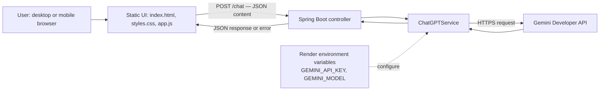

# Chatbot architecture

## System context

The application is a small Spring Boot chatbot with a static HTML/CSS/JavaScript client. The browser sends a message to the backend; the backend calls the configured Gemini API and returns the generated response.

## Components

- **Static frontend** — `src/main/resources/static/index.html`, `styles.css`, and `app.js` render the responsive chat interface, suggested prompts, message states, and composer.
- **HTTP API** — `POST /chat` accepts a JSON body containing `content`. Empty or invalid input returns HTTP 400. Upstream/configuration failures are surfaced as HTTP 502 with an error field.
- **AI service** — `ChatGPTService` uses `GEMINI_API_KEY` for authentication and `GEMINI_MODEL` to select the model. The model setting has a configured default; set it to a model enabled for the Google AI Studio project.
- **Hosting** — Render builds/deploys the application from the repository using the Docker configuration. Secrets belong in Render environment settings, never in source control or browser JavaScript.
- **Quality checks** — GitHub Actions runs the Java build/tests and the Playwright UI suite. UI tests mock the chat endpoint, so CI does not need a real Gemini API key or consume Gemini quota.

## Request lifecycle

1. A user submits a message or selects a suggested prompt.
2. `app.js` sends the message to `POST /chat` as JSON.
3. The Spring controller validates the request and delegates to `ChatGPTService`.
4. The service calls Gemini using server-side credentials and the configured model.
5. The backend returns the generated response; the UI renders it. On errors, the UI presents an error state.

## Current boundaries

- The frontend sends the current message only; conversational history is not currently sent as context to the model.
- CI tests the app and UI behavior without calling the live Gemini API. A real integration check requires valid server-side credentials and may consume API quota.
- Render free services can sleep when idle, so the first request after inactivity may be slower.

## Related references

- [Figma UI design](https://www.figma.com/design/pfIAnz6ffMbZtdpjxyBtPY)
- [Repository README](../README.md)
- [Chatbot project skill](../.github/skills/chatbot-project/SKILL.md)
