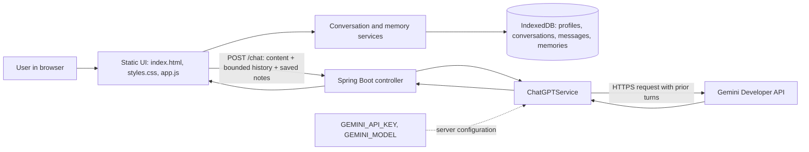

# Chatbot architecture

## System context

The application is a Spring Boot chatbot with a static HTML/CSS/JavaScript client. The browser sends the current message and bounded conversation context to the backend; the backend calls the configured Gemini API and returns the generated response.

## Components

- **Static frontend** — `src/main/resources/static/index.html`, `styles.css`, and `app.js` render the responsive chat UI, conversation list, local profile selector, saved-memory controls, message states, and composer.
- **Browser storage adapter** — `conversation-store.js` encapsulates IndexedDB CRUD for profiles, conversations, messages, and memories. The UI should use this adapter rather than calling IndexedDB directly.
- **Context builder** — `context-builder.js` selects a bounded window of recent messages and saved memories before sending a request.
- **HTTP API** — `POST /chat` accepts `content`, up to 12 prior messages, and up to 8 saved notes. Content and history are validated; the API response remains `{"response":"..." }`.
- **AI service** — `ChatGPTService` maps browser roles (`user`, `assistant`) to Gemini roles (`user`, `model`) and adds user-saved notes as explicitly untrusted reference data. API credentials remain server-side.
- **Hosting** — Render builds/deploys the application using the repository's Docker configuration. Secrets belong in hosting environment settings, never in source control or browser JavaScript.
- **Quality checks** — GitHub Actions runs Java build/tests and the Playwright UI suite. UI tests should mock `/chat` and must not consume Gemini API quota.

## Prototype persistence and identity boundaries

IndexedDB is the zero-additional-infrastructure-cost persistence adapter for this prototype. It survives refreshes and browser restarts in the same browser profile. Data does not automatically sync across devices or browsers, and clearing browser site data can delete it.

The profile selector is a local namespace, not authentication. It is useful for testing separate personas in one browser, but it does not provide verified identity, account recovery, or protection from another person using the same browser profile. Do not use this design as secure multi-user hosting.

Storage interfaces are intentionally isolated so an authenticated server-side adapter can replace IndexedDB later. The chat UI and context builder should not depend on IndexedDB APIs directly.

## Request lifecycle

1. The user selects or creates a local profile and opens a conversation.
2. The UI loads that profile's messages and saved memories from IndexedDB.
3. On submit, the user message is saved locally first.
4. The context builder selects up to 12 prior messages and 8 saved memories.
5. The UI sends the current message plus bounded context to `POST /chat`.
6. The controller validates the request and delegates to `ChatGPTService`.
7. The service calls Gemini using server-side credentials and sends prior turns with correct roles.
8. The response is saved locally and rendered. On failure, the user message remains marked failed so the UI can offer a retry path.

## Memory behavior

Memories are explicitly saved by the user and are scoped to the currently selected local profile. Users can inspect and delete them. Saved memories are reference data, not trusted instructions. The initial implementation sends the selected saved notes to the model; semantic relevance ranking and automatic memory extraction are future improvements.

## Future migration to server-side persistence

When secure multi-user accounts or cross-device sync are required:

1. Add real authentication and derive the account identity on the server.
2. Introduce storage interfaces for conversations, messages, and memories and implement a backend adapter.
3. Move identity ownership checks into the backend; never trust a client-supplied profile ID.
4. Add database migrations and a one-time export/import path from IndexedDB.
5. Keep the frontend repository contract stable so the UI does not need a rewrite.

## Related references

- [Figma UI design](https://www.figma.com/design/pfIAnz6ffMbZtdpjxyBtPY)
- [Repository README](../README.md)
- [Chatbot project skill](../.github/skills/chatbot-project/SKILL.md)
