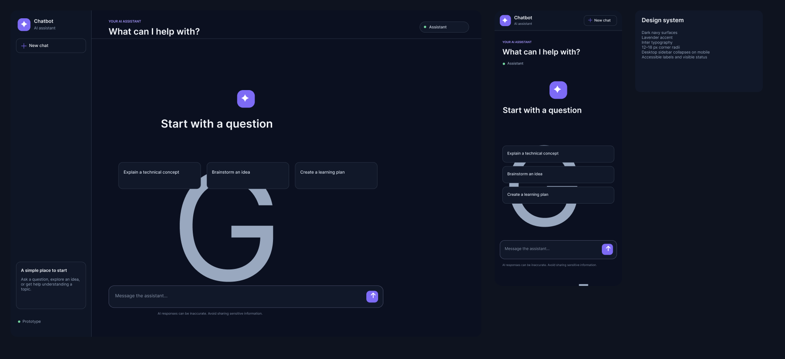

# Figma design screenshot reference

The authoritative, editable design is the [Chatbot — UI Design Figma file](https://www.figma.com/design/pfIAnz6ffMbZtdpjxyBtPY). It contains the desktop welcome screen, mobile welcome screen, and design notes.

## Committed preview

The screenshot is a static preview; use the Figma file for editable layers and the full design.

## Refresh the screenshot

When the design changes, capture the `Chatbot UI — Desktop + Mobile` frame in Figma and replace `docs/assets/figma-design.png` with the updated PNG.
